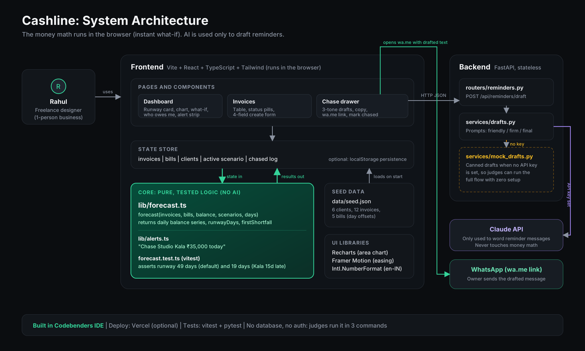

<!-- pitch, demo video, quick start, business model -->
# Cashline

**Cashline tells freelancers whether they can pay next month's rent, and who to chase today to make sure they can.**


▶ [Watch the full 3-minute demo](DEMO_VIDEO_LINK)

Built for the Codebenders ACE Builders' Hackathon 2026, Problem Statement 1: *The One-Person Back Office*.

---

## The problem

**Rahul, 28, is a freelance brand designer in Bengaluru.** He has **₹1.31L unpaid** across four clients, **rent due in 19 days**, and he tracks everything in a notebook and WhatsApp.

Freelancers don't fail from a lack of clients. They fail because **money arrives late and bills arrive on time**. Rahul can't say who owes him what, since when, or whether he can cover next month's bills.

## The solution

Cashline is a one-person back office with a 90-day cash forecast.

| What Rahul asks | What Cashline shows |
|---|---|
| Who owes me, how much, and since when? | Overdue invoices grouped by age (0-30, 31-60, 60+ days) |
| Am I safe next month? | A runway card: **"You're safe for 49 days"** |
| What if my biggest client pays late? | Pick **"Studio Kala pays 15 days late"** and runway drops from **49 to 19 days** with a shortfall at the first rent payment. The original line stays ghosted for comparison |
| What should I do today? | An alert such as **"Chase Studio Kala ₹35,000, never chased"**, which opens a drafted WhatsApp reminder |

[SCREENSHOT: dashboard]

[SCREENSHOT: what-if scenario]

[SCREENSHOT: chase drawer]

## Quick start

Requirements: Node 18+ and Python 3.10+.

```bash
npm run setup   # installs frontend and backend dependencies
npm run dev     # starts both servers
npm test        # runs vitest and pytest
```

Open the URL printed in the terminal (usually http://localhost:5173).

**Mock mode works with no API key.** Leave `LLM_API_KEY` empty and the app runs in mock mode, where the Chase drawer returns canned reminder drafts. To use a live provider, set `LLM_API_KEY`, `LLM_BASE_URL` and `LLM_MODEL` in your shell before starting the backend, for example `$env:LLM_API_KEY="..."` in PowerShell. The backend does not load `.env` files automatically. Set `LLM_BASE_URL` to the `<provider base URL>` of any OpenAI-compatible service, such as Groq, Gemini or OpenRouter. `.env.example` lists the variables.

All data is fictional seed data in `frontend/src/data/seed.json` (6 clients, 12 invoices, 5 recurring bills).

## Business model

| | |
|---|---|
| **Who pays** | The freelancer or one-person business owner |
| **Price** | Free for 5 invoices, then **₹299/month** |
| **Why they switch** | It pays for itself if it helps recover one late invoice. A notebook records what happened, and Cashline predicts what will happen and tells you what to do |
| **Cost to serve** | Very low. The forecast runs in the browser, and AI is used only to word reminder messages |
| **Competitors** | Vyapar, Khatabook, Zoho Invoice. They record invoices and payments. Cashline's edge is the forward-looking cash forecast with what-if scenarios, plus a clear next action |
| **First 100 users** | Indian freelance designer communities, Behance and X (Twitter) groups, and design-school alumni networks, through a free "check your 90-day runway" offer |

## How it's built



- **Frontend:** Vite, React, TypeScript, Tailwind, Recharts, Framer Motion
- **Backend:** FastAPI; reminder drafts via the OpenAI SDK to any OpenAI-compatible provider
- **No database or auth** by design, so anyone can run it in three commands

**The forecast is pure, tested code, not AI.** `frontend/src/lib/forecast.ts` takes invoices, bills, balance and scenarios and returns the daily balance, runway and first shortfall. Rules:

- Expected payment day = due day + the client's average delay
- Overdue invoices are expected no earlier than day 2
- Draft and paid invoices are excluded
- Bills repeat every 30 days

Tests assert the demo numbers: **49 days** by default and **19 days** in the Studio Kala scenario. An LLM is used only to draft the wording of reminders, never for money calculations.

## How I built this in Codebenders

1. Wrote a one-page spec (user, screens, data model, forecast rules) in `NOTES.md` before the first prompt.
2. Gave the IDE the exact folder structure and had it create empty files first.
3. Built in small vertical slices with a commit after each: scaffold, forecast engine and tests, chart, what-if, ageing list and alerts, invoices, chase drawer, polish.
4. Kept the seed data and forecast rules fixed, and asked for tests before UI.

Key prompts and what went wrong along the way: [`docs/codebenders-prompts.md`](docs/codebenders-prompts.md)

## Roadmap

- Mobile app (Expo) with push alerts for "chase today"
- UPI payment links inside reminders
- Bank and UPI statement import to reconcile payments automatically

## License

MIT