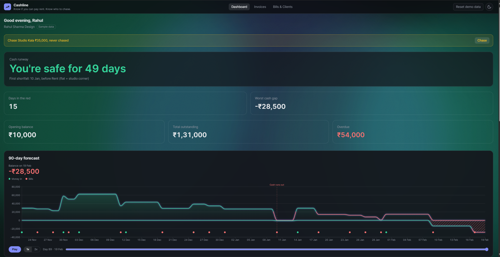
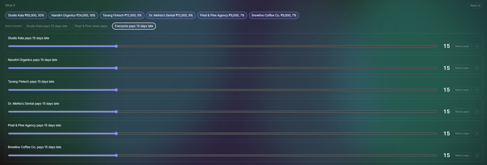
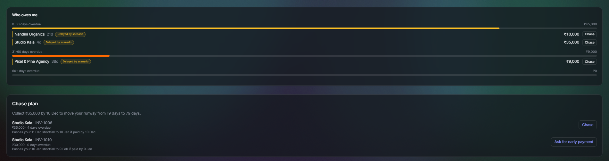

# Cashline

**Cashline tells freelancers whether they can pay next month's rent, and who to chase today to make sure they can.**

*Built by Arjun for the Codebenders ACE Builders' Hackathon 2026, Problem Statement 1: The One-Person Back Office.*


▶ [Watch the full 3-minute demo](DEMO_VIDEO_LINK)

---

## The problem 

**Rahul, 28, is a freelance brand designer in Bengaluru.** He has **₹1.31L unpaid** across six clients, **rent due in 19 days**, and he tracks everything in a notebook and WhatsApp.

Freelancers don't fail from a lack of clients. They fail because **money arrives late and bills arrive on time**. Rahul can't say who owes him what, since when, or whether he can cover next month's bills.

## The solution

Cashline is a one-person back office with a 90-day cash forecast.

| What Rahul asks | What Cashline shows |
|---|---|
| Who owes me, how much, and since when? | Overdue invoices grouped by age (0-30, 31-60, 60+ days) |
| Am I safe next month? | A runway card: **"You're safe for 49 days"**, with days in the red and the worst cash gap |
| What if a client pays late? | Pick **any client with a pending payment**, set a delay (or "never pays"), and the forecast redraws instantly. **Studio Kala 15 days late takes runway from 49 to 19 days.** The original line stays ghosted for comparison |
| Which client can hurt me most? | A ranking that simulates each client paying late or never, with their share of pending money and the impact on cash |
| What should I do today? | An alert such as **"Chase Studio Kala ₹35,000, never chased"**, plus a chase plan that puts overdue invoices first |
| How do I word the reminder? | A drawer with friendly, firm and final WhatsApp drafts, Copy, and Open in WhatsApp |

**More features:** a 90-day replay that plays the forecast day by day, an invoice flow (create, mark paid), recurring bills, client payment history, light and dark themes, and a **Reset demo data** button.








## Quick start

Requirements: Node 20+ and Python 3.10+.

```bash
npm run setup   # installs root, frontend and backend dependencies
npm run dev     # starts the frontend and the FastAPI backend together
npm test        # runs vitest (frontend) and Python unittest (backend)
```

Open the URL printed in the terminal (usually http://localhost:5173). The API's interactive docs are at http://127.0.0.1:8000/docs.

All data is **fictional seed data** in `frontend/src/data/seed.json` (6 clients, 12 invoices, 5 recurring bills). Dates are relative to today, so the demo always starts from a realistic position.

### Reminder drafts: mock mode and live AI

**No API key is needed.** Without one, the Chase drawer returns template drafts and shows "Sample drafts (no API key set)". The API response includes `"mode": "mock"`.

For live AI drafts, set three variables in the terminal **before starting the backend**. The backend does not read `.env` files, so a key never lands in a file. Any OpenAI-compatible provider works. Example with Groq (free tier):

```powershell
# Windows PowerShell
$env:LLM_API_KEY = "your-key"
$env:LLM_BASE_URL = "https://api.groq.com/openai/v1"
$env:LLM_MODEL = "openai/gpt-oss-20b"
npm run dev
```

```bash
# macOS / Linux
export LLM_API_KEY="your-key"
export LLM_BASE_URL="https://api.groq.com/openai/v1"
export LLM_MODEL="openai/gpt-oss-20b"
npm run dev
```

Model names change, so check your provider's current list. If a live call fails or is rate-limited, the app falls back to the template drafts instead of showing an error. `.env.example` lists the variables.

## Business model

| | |
|---|---|
| **Who pays** | The freelancer or one-person business owner |
| **Price** | Free for 5 invoices, then **₹299/month** |
| **Why they switch** | It pays for itself if it helps recover one late invoice. A notebook records what happened, and Cashline predicts what will happen and tells you what to do |
| **Cost to serve** | Very low. The forecast runs in the browser, and AI is used only to word reminder messages |
| **Competitors** | Vyapar, Khatabook and Zoho Invoice focus on recording invoices and payments. Cashline's edge is the forward-looking cash forecast with what-if scenarios, and a clear next action |
| **First 100 users** | Indian freelance designer communities, Behance and X (Twitter) groups, and design-school alumni networks, through a free "check your 90-day runway" offer |

## How it's built


- **Frontend:** Vite, React, TypeScript, Tailwind, Recharts, Framer Motion
- **Backend:** FastAPI, stateless. One endpoint drafts reminders through the OpenAI SDK to any compatible provider, with a template fallback
- **No database or auth** by design, so anyone can run it in three commands

**The forecast is pure, tested code, not AI.** `frontend/src/lib/forecast.ts` takes invoices, bills, balance and scenarios and returns the daily balance, runway and first shortfall. It runs in the browser, so the what-if is instant. Rules:

- Expected payment day = due day + the client's average delay
- Overdue invoices are expected no earlier than day 2
- Draft and paid invoices are excluded
- Bills repeat every 30 days

An LLM is used only to word reminders, never for money calculations.

### Tests

**46 frontend tests and 8 backend tests**, including:

- The demo numbers read from the seed: **49 days** by default and **19 days** in the Studio Kala scenario
- Ageing buckets, alerts, chase-plan ranking and scenario metrics
- The backend falling back to template drafts when a live call fails or is rate-limited

```bash
npm test
```

## How I built this in Codebenders

1. Wrote a one-page spec (user, screens, data model, forecast rules) in `NOTES.md` before the first prompt.
2. Gave the IDE the exact folder structure and had it create empty files first.
3. Built in small vertical slices with a commit after each: forecast engine and tests, chart, what-if, ageing list and alerts, invoices, chase drawer, polish.
4. Kept the seed data and forecast rules fixed, and asked for tests before UI. That caught real issues, such as a 90-day window counted as 91 days.

Key prompts and what went wrong along the way: [`docs/codebenders-prompts.md`](docs/codebenders-prompts.md)

## Project structure

```
frontend/src/lib/       forecast, alerts, chase plan, scenario metrics (pure, tested)
frontend/src/data/      seed.json
frontend/src/components dashboard, invoices, chase drawer, UI
backend/                FastAPI app, reminder router and draft services
docs/                   architecture diagram, screenshots, prompt log
```

## Roadmap

- Mobile app (Expo) with push alerts for "chase today"
- UPI payment links inside reminders
- Bank and UPI statement import to reconcile payments automatically
- A follow-up cycle that re-raises an alert a few days after an invoice is chased

## License

MIT
